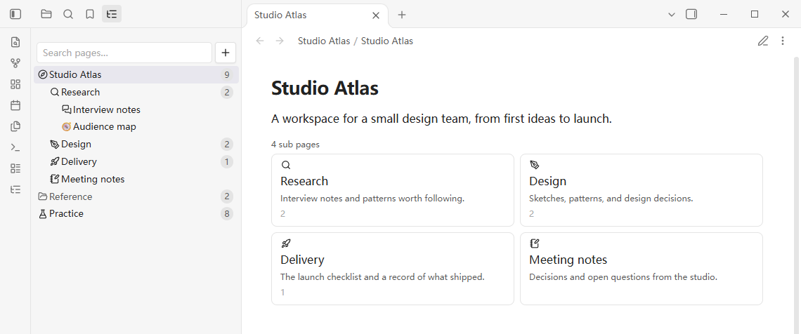
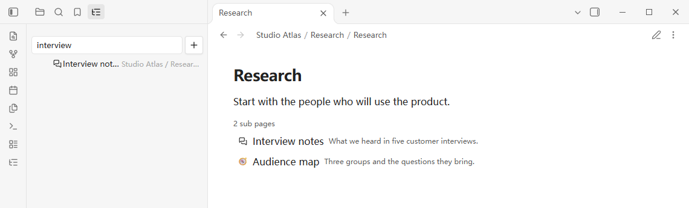

# Sub Page

[简体中文](README.zh-CN.md)

Browse and organize your Obsidian notes as nested pages in a sidebar. Add the same child pages to a note as a list or a card grid. Sub Page can show your existing vault as a tree as soon as you open it.



Try it with the [Studio Atlas example vault](demo-vault/).

## What you can do

- **Browse and search your page tree** alongside Obsidian’s file explorer. Click a parent page’s title to open the note and show its children. Click the title again to collapse them. The icon toggles the list on its own.
- **Create and organize pages** from the sidebar. Use **+** to create a page, or right-click a page and choose **New sub page**. On desktop, drag to the center of a row to make a page its child, or to the top or bottom edge to reorder it. On mobile, long-press a page to open its menu and use **Move up** or **Move down**. The context menu can also copy a page link, its vault-relative path, or its absolute path.
- **Show child pages inside a note** as a list or card grid, with optional icons and descriptions.



## Get started

1. Open the page tree from the **Sub Page** icon in the left ribbon or run **Sub Page: Open sub page panel** from the command palette. The panel first opens in the left sidebar. Run **Sub Page: Collapse native file explorer** if you want more room for the page tree.
2. Leave **Page root** blank to show the whole vault, or choose a folder in the plugin settings. Enable **Show empty folders** to see folders without pages.
3. Add this block to a note and switch to Reading view to see that note’s child pages.

   ````markdown
   ```subpages
   view: list
   sort: manual
   ```
   ````

## How notes become parent pages

A note with the same name as its containing folder represents that folder in the tree. For example, `Java/JVM/JVM.md` is the JVM parent page, and `Java/JVM/Garbage collection.md` is one of its children. A folder without a matching note groups the pages it contains.

A new page starts as a regular note. When it receives its first child, Sub Page moves the original note into a matching folder. With **Restore pages that have no children** enabled by default, Sub Page moves the original note back up one level when it is the only item left and sends the empty folder to the vault trash. The folder stays in place if a note with the same name already exists at the destination. Turn this setting off to keep parent folders.

## Customize the child-page list

| Option | Values | Default |
| --- | --- | --- |
| `view` | `list` or `card` | Plugin setting |
| `sort` | `name`, `created`, `modified`, or `manual` | Plugin setting |
| `show-icon` | `true` or `false` | `true` |
| `show-description` | `true` or `false` | `false` |
| `columns` | Number of columns in card view | `2` |
| `limit` | Maximum number of pages, or `0` for all | `0` |

To customize a page’s icon and description, add `icon` and `description` in its Obsidian Properties. The icon can be an emoji like `📁` or a value like `lucide:folder`.

## Work with an agent

In Sub Page settings, choose **Install Agent Skill** to preview and install a note organization guide in this vault. You can choose the skills folder and add an editable instruction to the vault’s `AGENTS.md`. Existing rules outside the Sub Page section are preserved.

## Install

Sub Page supports Obsidian 1.15.0 or newer on desktop and mobile.

For manual installation, place the release files `main.js`, `manifest.json`, and `styles.css` in your vault’s `.obsidian/plugins/sub-page/` folder. Restart Obsidian and enable **Sub Page** under **Settings → Community plugins**. [GitHub Releases](https://github.com/aStudyMachine/sub-page/releases)

[Contributing](CONTRIBUTING.md) · [MIT License](LICENSE)
